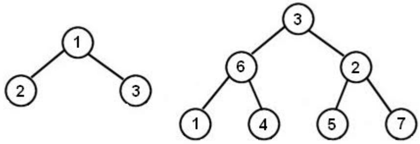

# 9934: 완전 이진 트리

[Problem link](https://www.acmicpc.net/problem/9934)

Solution: [9934.cpp](9934.cpp)

| Time limit | Memory limit |
| --- | --- |
| 1 s | 128 MB |

## Problem

상근이는 슬로베니아의 도시 Donji Andrijevci를 여행하고 있다. 이 도시의 도로는 깊이가 K인 완전 이진 트리를 이루고 있다. 깊이가 K인 완전 이진 트리는 총 2<sup>K</sup>-1개의 노드로 이루어져 있다. (아래 그림) 각 노드에는 그 곳에 위치한 빌딩의 번호가 붙여져 있다. 또, 가장 마지막 레벨을 제외한 모든 집은 왼쪽 자식과 오른쪽 자식을 갖는다.



깊이가 2와 3인 완전 이진 트리

상근이는 도시에 있는 모든 빌딩에 들어갔고, 들어간 순서대로 번호를 종이에 적어 놓았다. 한국으로 돌아온 상근이는 도시가 어떻게 생겼는지 그림을 그려보려고 하였으나, 정확하게 기억이 나지 않아 실패했다. 하지만, 어떤 순서로 도시를 방문했는지 기억해냈다.

1. 가장 처음에 상근이는 트리의 루트에 있는 빌딩 앞에 서있다.
2. 현재 빌딩의 왼쪽 자식에 있는 빌딩에 아직 들어가지 않았다면, 왼쪽 자식으로 이동한다.
3. 현재 있는 노드가 왼쪽 자식을 가지고 있지 않거나 왼쪽 자식에 있는 빌딩을 이미 들어갔다면, 현재 노드에 있는 빌딩을 들어가고 종이에 번호를 적는다.
4. 현재 빌딩을 이미 들어갔다 온 상태이고, 오른쪽 자식을 가지고 있는 경우에는 오른쪽 자식으로 이동한다.
5. 현재 빌딩과 왼쪽, 오른쪽 자식에 있는 빌딩을 모두 방문했다면, 부모 노드로 이동한다.

왼쪽 그림에 나와있는 마을이라면, 상근이는 2-1-3 순서대로 빌딩을 들어갔을 것이고, 오른쪽 그림의 경우에는 1-6-4-3-5-2-7 순서로 들어갔을 것이다. 상근이가 종이에 적은 순서가 모두 주어졌을 때, 각 레벨에 있는 빌딩의 번호를 구하는 프로그램을 작성하시오.

## Input

첫째 줄에 K (1 ≤ K ≤ 10)가 주어진다.

둘째 줄에는 상근이가 방문한 빌딩의 번호가 들어간 순서대로 주어진다. 모든 빌딩의 번호는 중복되지 않으며, 구간 [1,2<sup>K</sup>)에 포함된다.

## Output

총 K개의 줄에 걸쳐서 정답을 출력한다. i번째 줄에는 레벨이 i인 빌딩의 번호를 출력한다. 출력은 왼쪽에서부터 오른쪽 순서대로 출력한다.

## Sample Input 1

```text
2
2 1 3
```

## Sample Output 1

```text
1
2 3
```

## Sample Input 2

```text
3
1 6 4 3 5 2 7
```

## Sample Output 2

```text
3
6 2
1 4 5 7
```

## Source

[Contest](https://www.acmicpc.net/category/45) > [Croatian Open Competition in Informatics](https://www.acmicpc.net/category/17) > [COCI 2013/2014](https://www.acmicpc.net/category/272) > [Contest #5](https://www.acmicpc.net/category/detail/1230) 2번

- 문제를 번역한 사람: [baekjoon](https://www.acmicpc.net/user/baekjoon)
- 문제의 오타를 찾은 사람: [rhs0266](https://www.acmicpc.net/user/rhs0266)
