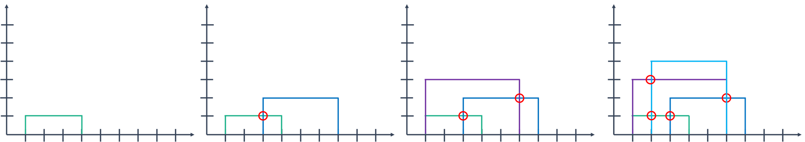

# 2934: LRH 식물

[Problem link](https://www.acmicpc.net/problem/2934)

Solution: [2934.cpp](2934.cpp)

| Time limit | Memory limit |
| --- | --- |
| 1 s | 128 MB |

## Problem

상근이는 유전자 조작을 통해 줄기 두 개로 이루어진 식물을 만들었다. 이 식물은 줄기의 x좌표 L, R과 높이 H로 나타낼 수 있다. 아래 그림은 L=2, R=5, H=4인 식물이다.


상근이는 매일 매일 화단에 식물을 하나씩 심는다. 첫 번째 날에 심은 식물의 높이는 1이고, 그 다음날에 심은 식물은 전날에 심은 식물의 높이보다 1 크다.

새 식물의 줄기가 다른 식물의 수평 선분과 교차하는 경우가 있다. 이러한 경우에 그 위치에는 꽃이 하나 피게 된다. (이미 꽃이 있는 경우에는 꽃이 더 피지 않는다) 점에서 접하는 경우에는 꽃이 피지 않는다.

아래 그림은 예제를 나타낸 것이다.



모든 식물의 좌표가 주어졌을 때, 매일 매일 피는 꽃의 개수를 구하는 프로그램을 작성하시오.

## Input

첫째 줄에 식물을 심은 날의 수 N (1 ≤ N ≤ 100,000)이 주어진다.

다음 N개 줄에는 매일 매일 심은 식물의 두 줄기 좌표 L과 R이 주어진다. (1 ≤ L < R ≤ 100,000)

## Output

총 N개의 줄에 매일 매일 핀 꽃의 수를 출력한다.

## Sample Input 1

```text
4
1 4
3 7
1 6
2 6
```

## Sample Output 1

```text
0
1
1
2
```

## Sample Input 2

```text
5
1 3
3 5
3 9
2 4
3 8
```

## Sample Output 2

```text
0
0
0
3
2
```

## Source

[Olympiad](https://www.acmicpc.net/category/2) > [Croatian Highschool Competitions in Informatics](https://www.acmicpc.net/category/25) > [2009](https://www.acmicpc.net/category/29) > [Croatian Regional Competition in Informatics 2009](https://www.acmicpc.net/category/detail/91) 6번

[Olympiad](https://www.acmicpc.net/category/2) > [Croatian Highschool Competitions in Informatics](https://www.acmicpc.net/category/25) > [2009](https://www.acmicpc.net/category/29) > [Regional Competition - Seniors](https://www.acmicpc.net/category/detail/1070) 4번

- 문제를 번역한 사람: [baekjoon](https://www.acmicpc.net/user/baekjoon)
- 문제의 오타를 찾은 사람: [metadata](https://www.acmicpc.net/user/metadata)
