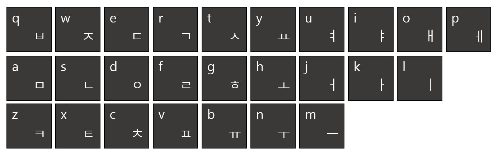

# 20436: ZOAC 3

[Problem link](https://www.acmicpc.net/problem/20436)

Solution: [3-5_20436.cpp](3-5_20436.cpp)

| Time limit | Memory limit |
| --- | --- |
| 1 s | 1024 MB |

## Problem

2020년 12월, 세 번째로 개최된 ZOAC의 오프닝을 맡은 성우는 누구보다 빠르게 ZOAC를 알리려 한다.

하지만 안타깝게도 성우는 독수리타법이다!

- 독수리 타법이란 양 손의 검지손가락만을 이용해 타자를 치는 타법이다.
- 성우는 한글 자음 쪽 자판은 왼손 검지손가락으로 입력하고, 한글 모음 쪽 자판은 오른손 검지손가락으로 입력한다.
- *a*의 좌표가 (x<sub>1</sub>, y<sub>1</sub>)이고, *b*의 좌표가 (x<sub>2</sub>, y<sub>2</sub>)일 때, *a*에 위치한 성우의 손가락이 *b*로 이동하는 데에는 *a*와 *b*의 택시 거리 |x<sub>1</sub>-x<sub>2</sub>|+|y<sub>1</sub>-y<sub>2</sub>| 만큼의 시간이 걸린다.
- 각 키를 누르는 데에는 1의 시간이 걸린다.
- 성우는 두 손을 동시에 움직일 수 없다.
- 성우가 사용하는 키보드는 쿼티식 키보드이며, 아래 그림처럼 생겼다.

  

바쁜 성우를 위하여 해당 문자열을 출력하는 데 걸리는 시간의 최솟값을 구해보자.

## Input

첫 번째 줄에는 두 알파벳 소문자 *s<sub>L</sub>*, *s<sub>R</sub>*이 주어진다. *s<sub>L</sub>*, *s<sub>R</sub>*은 각각 왼손 검지손가락, 오른손 검지손가락의 처음 위치이다.

그 다음 줄에는 알파벳 소문자로 구성된 문자열이 주어진다. 문자열의 길이는 최대 100자이다. 빈 문자열은 주어지지 않는다.

## Output

입력으로 주어진 문자열을 출력하는 데에 걸리는 시간의 최솟값을 출력한다.

## Sample Input 1

```text
z o
zoac
```

## Sample Output 1

```text
8
```

## Hint

성우가 두 손을 동시에 움직이지 못하는 이유는 다음과 같다.

- 사람은 두 가지 이상의 일을 동시에 할 수 없다.
- 대학원생은 사람이다.
- 성우는 대학원생이다.

## Source

[University](https://www.acmicpc.net/category/5) > [한양대학교 ERICA 캠퍼스](https://www.acmicpc.net/category/418) > [Zero One Algorithm Contest 2020](https://www.acmicpc.net/category/detail/2374) A번

- 문제를 만든 사람: [high092](https://www.acmicpc.net/user/high092)
- 문제를 검수한 사람: [bsyun0571](https://www.acmicpc.net/user/bsyun0571), [dlstj0923](https://www.acmicpc.net/user/dlstj0923), [hellogaon](https://www.acmicpc.net/user/hellogaon), [rasauq1122](https://www.acmicpc.net/user/rasauq1122), [rhs0266](https://www.acmicpc.net/user/rhs0266), [TheKinGoD](https://www.acmicpc.net/user/TheKinGoD), [tony9402](https://www.acmicpc.net/user/tony9402)
