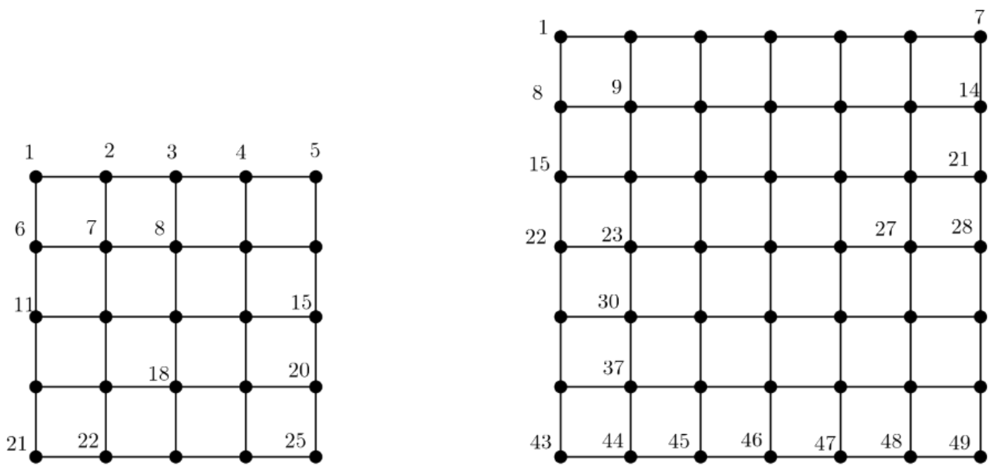
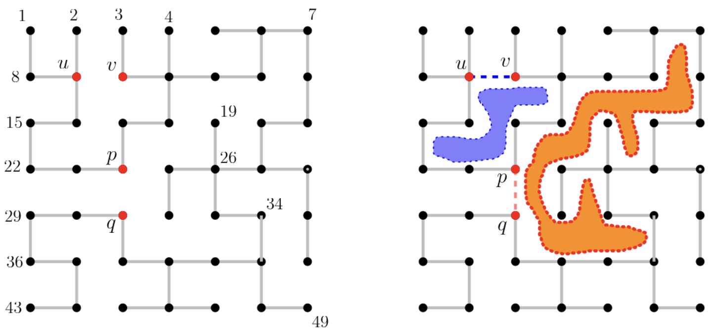
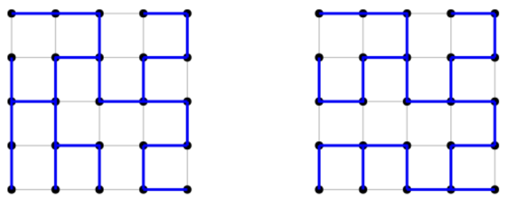

# 34862: Bay

[Problem link](https://www.acmicpc.net/problem/34862)

Solution: [34862.cpp](34862.cpp)

| Time limit | Memory limit |
| --- | --- |
| 1 s | 2048 MB |

## Problem

We have a grid (lattice) graph $G(n, n)$, where $n$ is the number of vertices along both the $x$-axis and the $y$-axis, that is, the number of rows and columns. The vertices of the graph $G(n, n)$ are numbered consecutively from $1$ to $n^2$ in row-major ordering; starting from the top-left vertex, we traverse row by row from top to bottom, and within each row from left to right. Figure 1 shows two examples, $G(5, 5)$ and $G(7, 7)$ with vertex numbers.



**Figure 1**. Left: Grid graph $G(5,5)$. Right: $G(7,7)$.

We are given a spanning tree $T$ of $G(n, n)$. The left in Figure 2 shows a spanning tree $T$ of $G(7, 7)$. If we add an edge of $G(n, n)$ that does not belong to $T$ (called *non-tree edge*), then exactly one simple cycle is created. We define the region enclosed by this cycle as a *bay*. There is a one-to-one correspondence between non-tree edges and bays, that is, each non-tree edge corresponds to exactly one bay. The area of a bay is defined by number of $1 \times 1$ unit cells enclosed by the cycle. The right in Figure 2 shows two bays(colored blue and orange) created by adding two non-tree edges $(u, v)$ and $(p, q)$, respectively. Note that the areas of two bays created by $(u, v)$ and $(p, q)$ are $4$ and $12$, respectively.



**Figure 2**. A spanning tree $T$ of a grid $G(7, 7)$ and two bays created by $(u, v)$ and $(p, q)$.

Given a spanning tree $T$ of a grid graph $G(n, n)$ and a positive integer $S$, write a program that finds all non-tree edges that creates bays of area $S$ and outputs the first non-tree edge among them in lexicographical order.

## Input

Your program is to read from standard input. The input starts with a line containing two integers $n$ and $S$ where $5 ≤ n ≤ 300$ for $G(n, n)$ and $1 ≤ S ≤ (n − 1)^2$. Each of the following $n^2 − 1$ lines contains two distinct integers $u$ and $v$ representing an edge $(u, v)$ of a spanning tree $T$, where $1 ≤ u < v ≤ n^2$.

## Output

Your program is to write to standard output. The first line should contain the number of non-tree edges that create the bays of area $S$. The second line should contain two distinct integers $u$ and $v$ ($u < v$) representing the first non-tree edge $(u, v)$ in lexicographical order among those that create the bays of area $S$. The lexicographical order of two edges $(a, b)$ and $(c, d)$ is defined such that $(a, b)$ comes before $(c, d)$ if and only if $a < c$ or, if $a = c$ then $b < d$. If there is no non-tree edge that creates the bay of area $S$, then print “`0`” in the first line and two zeros “`0 0`” in the second line.

Figure 3 shows two spanning trees of a grid graph with $n = 5$, which are the sample inputs and outputs.



**Figure 3**. Two spanning trees of $G(5, 5)$ for Sample Input 1 and 2.

## Sample Input 1

```text
5 2
1 2
2 3
3 8
4 5
5 10
6 11
7 8
7 12
8 13
9 10
9 14
11 12
11 16
12 17
13 14
14 15
15 20
16 21
17 18
17 22
18 23
19 20
19 24
24 25
```

## Sample Output 1

```text
2
13 18
```

## Sample Input 2

```text
5 2
1 2
2 3
3 8
4 5
5 10
6 11
7 8
7 12
8 13
9 10
9 14
11 12
13 14
14 15
15 20
16 17
16 21
17 18
17 22
18 23
19 20
19 24
23 24
24 25
```

## Sample Output 2

```text
0
0 0
```

## Source

[ICPC](https://www.acmicpc.net/category/1) > [Regionals](https://www.acmicpc.net/category/7) > [Asia Pacific](https://www.acmicpc.net/category/42) > [Korea](https://www.acmicpc.net/category/211) > [2025 ICPC Asia Seoul Regional](https://www.acmicpc.net/category/detail/4608) C번
