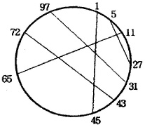

# 2673: 교차하지 않는 원의 현들의 최대집합

[Problem link](https://www.acmicpc.net/problem/2673)

Solution: [2673.cpp](2673.cpp)

| Time limit | Memory limit |
| --- | --- |
| 1 s | 128 MB |

## Problem

평면상에 있는 원의 둘레에 100개의 점이 일정한 간격으로 시계방향으로 번호가 1, 2, ... 100으로 붙여져 있다. 이 점들을 끝점으로 갖는 N개의 선분(원의 현)이 입력으로 주어질 때, 이들중에서 서로 교차하지 않는 것들을 최대한 많이 찾아서 그 개수를 출력하는 프로그램을 작성하라.

단, 1 ≤ N ≤ 50이고, 주어진 각 점은 많아야 한 현의 끝점이 될 수 있다.

## Input

첫 번째 줄은 주어지는 현의 개수 N이고, 다음의 N줄은 각 현의 양끝점의 번호가 주어진다.

## Output

구한 현의 개수를 출력한다.

## Sample Input 1

```text
5
97 31
1 45
27 5
11 65
43 72
```

## Sample Output 1

```text
3
```

## Hint



## Source

[Olympiad](https://www.acmicpc.net/category/2) > [한국정보올림피아드](https://www.acmicpc.net/category/55) > [KOI 1996](https://www.acmicpc.net/category/82) > [고등부](https://www.acmicpc.net/category/detail/405) 2번

- 데이터를 추가한 사람: [CookieHCl](https://www.acmicpc.net/user/CookieHCl)
